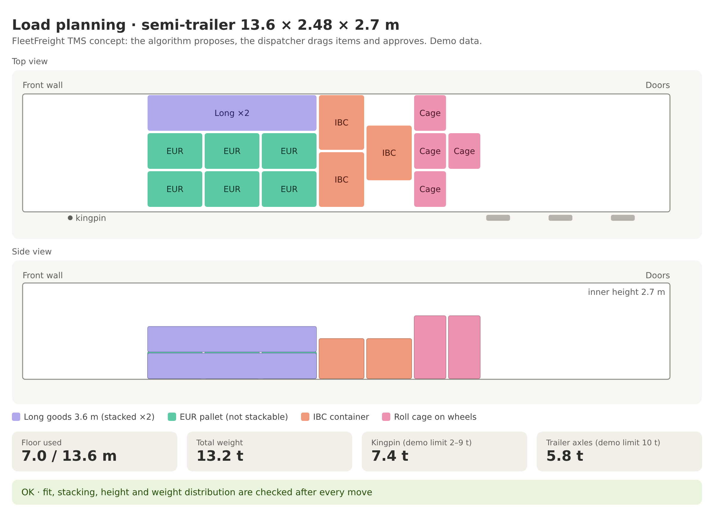
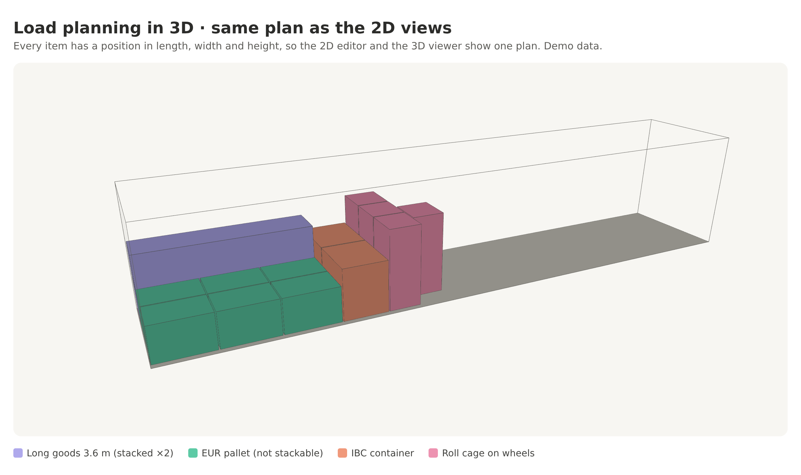

# FleetFreight TMS

Transport management system that combines **load planning** (orders, routing, trips, costs and margin) with **day-level fleet planning** (which jobs a driver and truck can complete today within EU driving, working and rest time rules).

> Portfolio project. All data is fictional demo data.

## Background

FleetFreight TMS merges two earlier prototypes by the same author:

- [Freight Planner](https://github.com/Vode72/freight-planner): order-to-trip planning, cost and pricing engine, carriers, trailers, ferries
- [FleetFlow Planner](https://github.com/Vode72/fleetflow-planner): daily traffic planning cockpit, job sequencing, map and driving-time checks

The new system is designed from what both prototypes taught, built by a traffic coordinator with ~25 years of logistics experience.

## Core ideas

- **Node–Leg model:** every trip is a chain of nodes (tractor start, trailer pickup, loading, terminal, port departure and arrival, unloading, workshop, washing) with a leg between each pair
- **Trip = one loaded round of a load unit** (a trailer or a truck's fixed body). Every movement is a trip built from an order, nodes and legs: freight, empty load unit, maintenance, washing, inspection or repositioning, with internal orders paid by the own company. Tractors can be swapped at any node; each tractor gets its own job, and drivers change within a job as time periods
- **Feasibility first:** the system calculates, checks and suggests; the traffic coordinator decides
- Accompanied and unaccompanied ferries, ADR, GDP, temperature-controlled and curtain-side transport, trailer pool, port handling

## Concept: load planning (planned)

Load planning in 2D and 3D is a planned module (proposal D91). An algorithm proposes where each item goes, and the traffic coordinator drags items and approves the plan. Fit, stacking, height and the weight on the kingpin and trailer axles are checked after every move, and a move that would make the load unsafe is blocked. The images are concept mockups with demo data.

## Stack

React · TypeScript · Vite · Python · FastAPI · PostgreSQL · Alembic · pytest · Vitest

## Status

Phase 1 complete; phase 2 (data model) in progress: user preferences, data model v1, parties and locations, fleet, countries and road restrictions, parking and border crossings, ferry and rail lines, and cargo crime risk done; register views (API and list views) next, then orders and trips (2C). See [docs/suunnitelma.md](docs/suunnitelma.md) (Finnish) for the decision register, data model and roadmap, and [backend/README.md](backend/README.md) for running the app.
