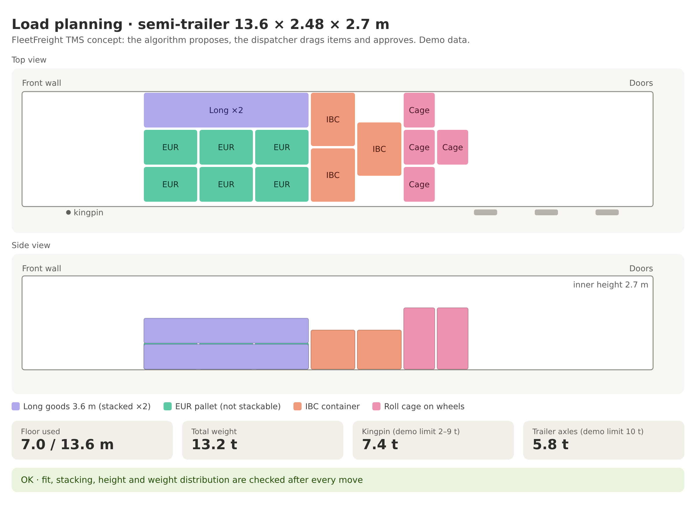
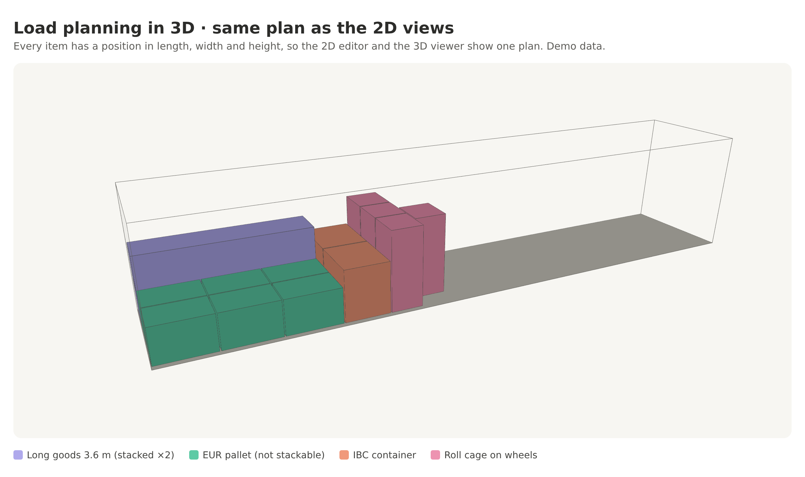

# Lastaussuunnittelu (2D ja 3D)

Tila: **Ehdotus** (D91, odottaa Tonin päätöstä) · Päivitetty 21.11.2026 (laajennettu: painojakauma legeittäin,
painopiste kolmessa suunnassa, sidonta ja tuenta, pistekuormat, yhteenlastauskiellot, lastaussuunta,
punnittu paino, kuormanjakokaavio, tiivistys, puhelimen siirtonuolet, kumoa ja versiot)

Kuorman sijoittelu kuormatilaan: järjestelmä ehdottaa, liikenteenohjaaja muokkaa ja hyväksyy (sääntö 8).
Moduuli on osa FleetFreight TMS:ää eikä erillinen sovellus, koska se käyttää samaa dataa kuin kuljetukset
(orderit, kollit, kuormatilat, tripit ja legit). Ketju: order → trippi → lastaussuunnitelma → CMR.

## 1. Paikka järjestelmässä

- Tripsuunnittelussa kuormatilalla on oma Lastaus-näkymä.
- Suunnitelma tehdään kuormatilalle, ja sen tila näytetään jokaiselle legille, koska PTL- ja LTL-kuorma
  muuttuu purkujen myötä (D37).

## 2. Käyttäjät

| Käyttäjä | Mitä tekee |
|---|---|
| Liikenteenohjaaja | Laatii, muokkaa ja hyväksyy suunnitelman |
| Terminaalin lastaaja | Näkee lastausohjeen puhelimella, kuittaa kollit ja tuennan sekä kirjaa punnitun painon |
| Kuljettaja | Näkee suunnitelman |

Kaikki käyttävät samaa suunnitelmaa omilla oikeuksillaan. Tulostettava lastausohje (PDF): kuormakuva
ylhäältä ja sivulta, kollilista lastausjärjestyksessä sekä tuenta- ja sidontaohje.

## 3. Tietomalli (taulut vaiheessa 2, jotta myöhempiä migraatioita ei tarvita)

| Taulu | Sisältö |
|---|---|
| `package_types` (kollilajit) | EUR, FIN, puolilava, IBC, häkkilava, rullakko, pitkä tavara, rulla, kela, rumpu ja vapaa mitta. Oletusmitat (muutettavissa order-rivillä), pinottavuus, päälle sallittu paino, pyörällinen (lukittava ja sidottava), saako kääntää, asento (kela makaa, rumpu seisoo), tarvitaanko kelakouru, tukipinta (pistekuorma) |
| `order_lines` (lisäykset) | kollilaji, mittojen ja pinottavuuden ylikirjoitus, "ei saa kääntää", käsittelymerkinnät ("tämä puoli ylös", "särkyvää"), ilmoitettu ja punnittu paino |
| `load_plans` | kuormatila ja trippi, versio, tila (Luonnos / Hyväksytty / Lukittu, kun lastaus alkaa), laskettu vai käsin muokattu, lastaussuunta (taka tai sivu) |
| `load_plan_items` | order-rivin kolli, sijainti kolmessa ulottuvuudessa (pituus, leveys, korkeus), kierto, kerros, lastauskuittaus |
| `load_plan_securing` | tuettavat välit, takapinnan varmistus ja sidonnat (tyyppi, paikka, arvioitu määrä, kuittaus) |
| `load_units` (lisäykset) | akseliston paikka, vetopöydän ja akseliston rajat tai valmistajan kuormanjakokaavion pisteet, lattian ja kelakourun kuormitusrajat; vetotapin etäisyys ja sisämitat ovat jo taulussa |

Oletusmitat ovat tyyppimittoja, eivät säädösarvoja; ne merkitään kollilajille muutettaviksi. Raja-arvot
(kuormanjakokaavio, lattia, kelakouru, sidonta) tulevat valmistajalta tai standardista lähteineen, eikä niitä
kirjoiteta muistista.

## 4. Laskenta (`domain/load_plan.py`, puhdas Python)

- Jokaisella kollilla on paikka kolmessa ulottuvuudessa ensimmäisestä versiosta lähtien. 2D- ja 3D-näkymät
  ovat saman suunnitelman eri kuvia.
- **Sijoittelu:** kerroksittain; jokainen uusi kolli asetetaan jo sijoitettujen kollien kulmiin ("extreme
  point" -heuristiikka). Järjestys: purkujärjestys (LIFO: ensin purettava ovien puolelle), sitten paino ja koko.
  Kuorma alkaa etuseinästä, vierekkäiset kaistat täytetään (esimerkiksi pitkä tavara ja EUR-lavat
  rinnakkain), painavat kollit alas.
- **Tarkistus:** erillinen `evaluate(plan)` palauttaa havainnot (BLOCKED, RISK, OPEN). Ehdotus ja käsin tehty
  muokkaus käyttävät samoja sääntöjä.
- **Painojakauma legeittäin:** painopiste sekä vetotapin ja akseliston kuorma lasketaan jokaiselle legille
  purkujen jälkeen, ei vain lähtötilanteelle. Purun jälkeen etupainoiseksi jäävä kuorma havaitaan.
- **Painopiste kolmessa suunnassa:** pituus (vetotappi ja akselisto), leveys (sivuttainen epätasapaino) ja
  korkeus (kaatumisriski).
- **Punnittu paino:** kun lastauksessa punnittu paino on kirjattu, laskenta käyttää sitä ilmoitetun sijaan.
- Samasta lähtötiedosta syntyy aina sama tulos.

## 5. Plan Check

| Tulos | Milloin |
|---|---|
| BLOCKED | kollit päällekkäin tai kuormatilan ulkopuolella; lattiapinta, korkeus tai paino ylittyy; painopiste kuormanjakokäyrän yläpuolella millä tahansa legillä; lattian tai kelakourun pistekuorma ylittyy; kielletty yhteenlastaus (ADR, elintarvike ja kemikaali, D56) |
| RISK | lähellä rajaa (oletus 85 %, asetus); LIFO-järjestys väärin; pinoamissääntöä rikotaan; sivuttainen epätasapaino; tukematon väli tai varmistamaton takapinta; käsittelymerkintää ei noudateta |
| OPEN | kollin mitat puuttuvat, tai kuormatilan kuormanjakokaavio, akseliston paikka, lattian tai kelakourun rajat puuttuvat (ei arvausta) |

Rajat kirjataan lähteistä kuten maiden painorajat (D89, D90).

## 6. Ehdotus ja muokkaus

- **Ehdotus:** optimointialgoritmi laskee sijoittelun. Algoritmi on deterministinen ja tarkistettava.
- **Tekoäly:** tilausagentti lukee orderin vapaan tekstin kolleiksi ("3 IBC + 4 rullakkoa"), muuttaa vapaat
  ohjeet algoritmin ehdoiksi ("IBC:t eteen, ei mitään rumpujen päälle"), perustelee ehdotuksen ja tarjoaa
  vaihtoehtoja. Tekoäly ei sijoittele kolleja itse.
- **Siirtäminen (tabletti ja tietokone):**
  - Kollia raahataan; raahauksen aikana päällekkäinen tai kuormatilan ulkopuolinen kohta näkyy punaisena.
  - Pudotettu kolli imeytyy lähimpään vapaaseen paikkaan ja liukuu etuseinää kohti ja sivuttain kiinni
    naapuriin, jotta turhia välejä ei jää. Jos paikkaa ei ole, kolli palaa alkuperäiselle paikalleen.
  - Kollit eivät koskaan jää päällekkäin: jokainen raahauksen loppu tarkistetaan, myös kun kosketusnäyttö
    keskeyttää raahauksen.
  - Pudotus toisen samankokoisen kollin päälle vaihtaa paikat; tarkistus tehdään lopputilanteelle.
  - Kääntö, jos kollilaji sallii.
  - Tiivistä-toiminto vetää kaikki kollit etuseinään ja toisiinsa, mutta ei muuta purkujärjestystä.
  - Pinoaminen on oma toimintonsa: kerros valitaan sivunäkymässä, ja vain pinottaville kollilajeille.
- **Puhelin:** siirtonuolet ja "vaihda paikkaa" -toiminto vapaan raahauksen sijaan; lisäksi katselu,
  lastauskuittaus ja punnitun painon kirjaus.
- **Jatkuva tarkistus:** painojakauma ja säännöt päivittyvät jokaisen siirron jälkeen. Siirto, joka tekisi
  kuormasta vaarallisen (BLOCKED), estetään ja kolli palaa paikalleen.
- **Kumoa ja versiot:** muutokset voi kumota. Suunnitelma lukitaan, kun lastaus alkaa; muutokset sen jälkeen
  tehdään uutena versiona (sääntö 9). Hyväksytty suunnitelma ei muutu automaattisesti.
- **Lastaussuunta:** verhokapelliperävaunun voi lastata sivulta, jolloin LIFO-sääntö koskee vain
  takaovelta purettavia kolleja.

## 7. Painojakauman näyttö

- **Painonauha:** kuormatilan alla kilogrammat metriä kohden värinä (värirajat asetuksia).
- **Painopistemerkki:** pystyviiva kuormatilan kuvassa, myös leveyssuunnassa.
- **Kuormanjakokaavio:** sallittu kuorman paino painopisteen paikan funktiona (valmistajan kaavio,
  kuormatilakohtainen) ja kuorman piste kaaviossa: vihreä, keltainen 85 %:sta, punainen yli rajan.
- **Vetotapin ja akseliston kuorma:** palkit rajoineen ja prosenttiosuus rajasta.
- **Legivalitsin:** näyttö jokaiselle legille purkujen jälkeen.

## 8. Sidonta ja tuenta

- Järjestelmä merkitsee tuettavat välit ja varmistettavan takapinnan ja arvioi sidontaliinojen määrän
  kitkan, painon ja kuorman muodon perusteella.
- Laskentatapa ja kertoimet tarkistetaan kuorman sidonnan standardista ennen toteutusta.
- Tulos näkyy lastausohjeessa, ja lastaaja kuittaa tuennan.

## 9. Toteutusjärjestys

1. Tietomalli, kollilajit ja demodata (vaihe 2)
2. **Versio 1:** yksi purkupaikka ja vain lavat: laskentamoduuli ja `evaluate`, painojakauma,
   kuormanjakokaavio, sivuttainen painopiste ja punnittu paino; testit satunnaisilla kuormilla (ei
   päällekkäisyyttä, ei kuormatilan ulkopuolelle, purkujärjestys pitää)
3. Useampi purkupaikka ja painojakauma legeittäin
4. Sekakuormat, pinoaminen, pistekuormat, käsittelymerkinnät ja yhteenlastauskiellot; sivulta lastaus
5. Sidonta ja tuenta
6. Akselipainot (vetoauton akselit, tyhjäpainot ja polttoaine) ja kahden lohkon FD-kuormatila (D76)

Käyttöliittymä etenee samassa järjestyksessä vaiheen 4 jälkeen: 2D-näkymä (SVG) muokkauksineen, 3D-näkymä
(three.js, ladataan vasta näkymää avattaessa), lastaajan kuittaukset ja PDF-lastausohje. Plan Check -säännöt
vaiheessa 5.

**Työnjako:** selain hoitaa geometrian heti (imu, törmäykset, tiivistys), backend tarkistaa painot ja säännöt
jokaisen pudotuksen jälkeen. Säännöt ovat vain backendissä, ja vastaus tulee alle sekunnissa.

## 10. Luonnokset

Kuvat ovat konseptiluonnoksia demodatalla (englanninkieliset tekstit README:tä varten); IBC:n ja häkkilavan
mitat ovat tyyppimittoja, painorajat demoarvoja. Kuorma on etuseinää vasten, IBC:t ja häkkilavat tiiviisti;
jäljelle jäävä väli tuetaan ja kuorman takapinta varmistetaan (lastaustuki tai sidonta). Siksi suurin osa
painosta on vetotapilla, ja kuva näyttää keltaisen varoituksen 85 %:sta.

Chatissa 21.11.2026 tehdyt luonnokset: ylänäkymä legivalitsimella ja LIFO-tarkistuksella; sekakuorma ylä-,
sivu- ja 3D-näkymänä; siirtäminen imulla, palautuksella ja painonjaon estolla; painonauha ja
kuormanjakokaavio; tiivis sijoittelu ja Tiivistä-toiminto.
